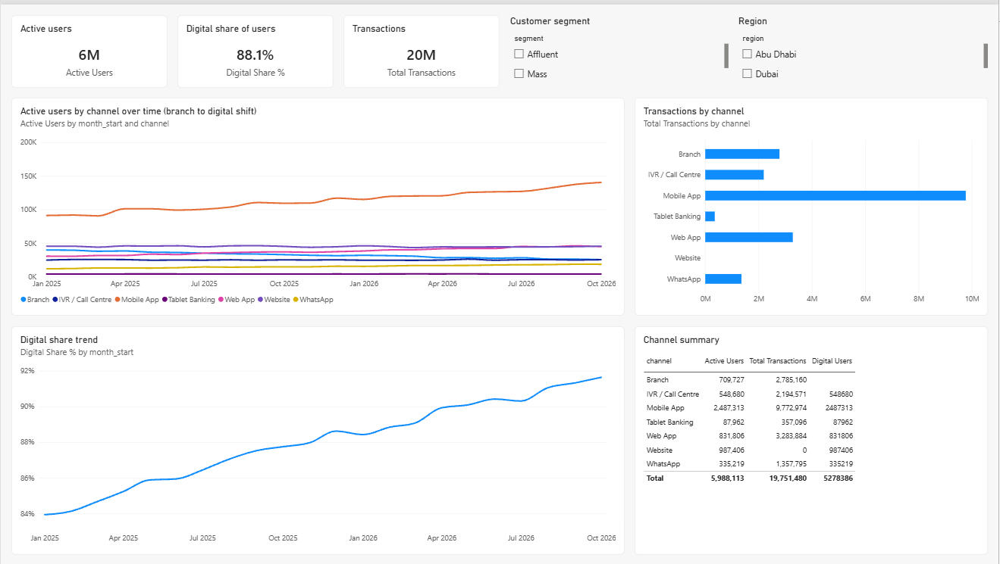
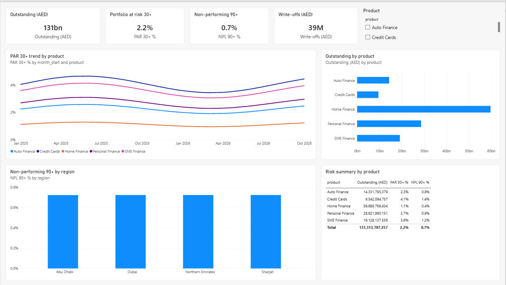

# Digital Banking & Risk Analytics (Power BI)

A two-page Power BI report for a retail bank's digital and credit teams, built on synthetic data (22 months, 7 channels, 4 customer segments, 4 regions, 5 loan products). No real bank data is used.

## Page 1: Digital channels

Questions it answers: how many customers use each channel, how fast usage is moving from branch to digital channels (mobile app, web, WhatsApp, IVR, tablet), and where transactions happen. Slicers for customer segment and region.

## Page 2: Credit risk and portfolio

Questions it answers: portfolio size by product, portfolio at risk (30+ days past due), non-performing loans (90+ days), write-offs, and how risk moves over time by product and region.

## Model

- Star schema: `dim_date` joined to `fact_channel_activity` and `fact_loan_portfolio` on month.
- DAX measures: Active Users, Digital Users (`KEEPFILTERS` so it respects the channel filter), Digital Share %, Total Transactions, Outstanding (AED), PAR 30+ %, NPL 90+ %, Write-offs (AED).
- Saved as a Power BI project (`.pbip`), so the model (TMDL) and report pages are readable text and version-controlled.

## Open it

Open `data/banking.pbip` in Power BI Desktop and click Refresh (data comes from `data/banking_data.xlsx`).

Basit Ali · [basitali-data.github.io](https://basitali-data.github.io)
